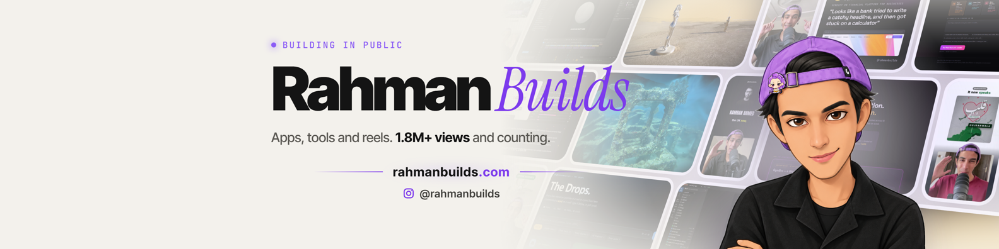
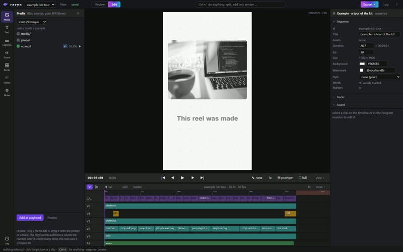
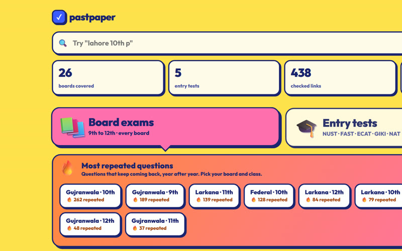
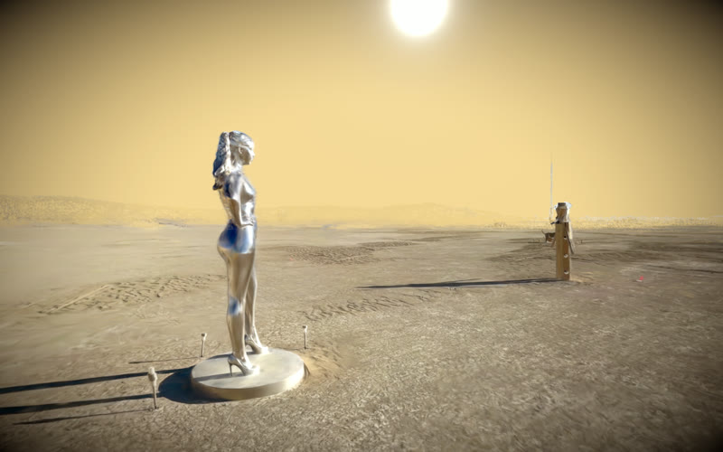
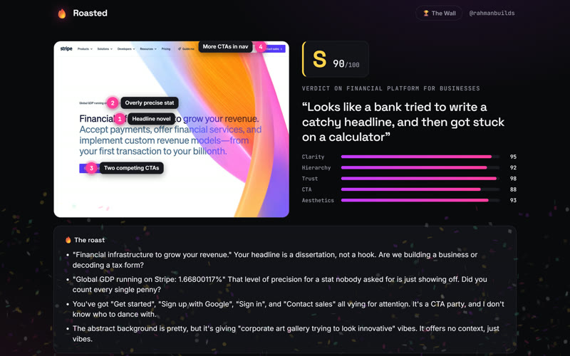
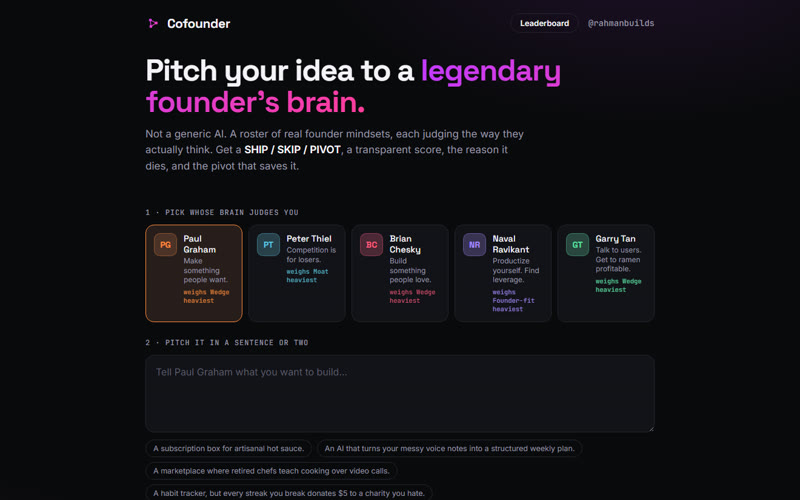
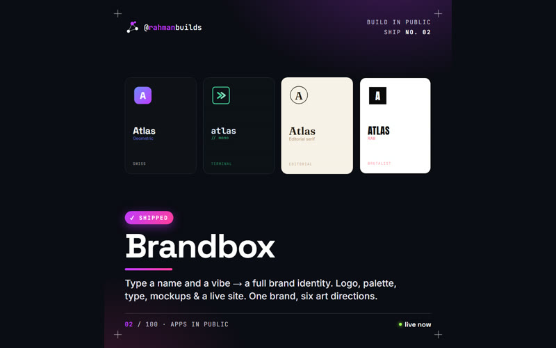
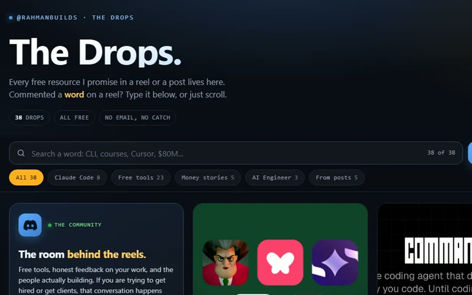

<h3 align="center">Hi, I'm Rahman. I build apps with AI and show the whole process on my reels.</h3>

  
  
  
  
  
  

- Based in Islamabad, Pakistan.
- Launched my first online game server at 10. 8+ servers since, with teams of 20 to 40 people.
- Now I build apps and tools with Claude Code, and post how I made them.
- Every reel comes with a free page: [rahmanbuilds.com/resources](https://rahmanbuilds.com/resources)

## ⭐ Free on GitHub

<table>
  <tr>
    <td width="50%"></td>
    <td width="50%">
      <h3><a href="https://github.com/RahmanBuildsAI/ravyn-reel-kit">ravyn reel kit</a></h3>
      
My own reel editor, the one I cut my reels in. It runs in your browser like Premiere, Claude Code edits the same project with you, and every note you leave becomes a rule.

      
Comes with 5 Claude Code skills, 11 styles and a worked example. Free to use.

      
<a href="https://github.com/RahmanBuildsAI/ravyn-reel-kit"><b>Get the kit &rarr;</b></a>

    </td>
  </tr>
</table>

## 🚀 Apps I've shipped

<table>
  <tr>
    <td width="50%" valign="top">
      
      <h3><a href="https://rahmanbuilds.com/pastpapers">Past Paper Finder</a></h3>
      
Every past paper in Pakistan, free. 26 boards, 5 entry tests, 29,737 practice questions. Built in one day with Claude Code.

    </td>
    <td width="50%" valign="top">
      
      <h3><a href="https://rahmanbuilds-dreamportal.vercel.app">Dream Portal</a></h3>
      
Fly through 14 real places, scanned in 3D, in your browser.

    </td>
  </tr>
  <tr>
    <td width="50%" valign="top">
      
      <h3><a href="https://rahmanbuilds-roasted.vercel.app">Roasted</a></h3>
      
Paste a URL and an AI design critic grades your landing page S to F.

    </td>
    <td width="50%" valign="top">
      
      <h3><a href="https://rahmanbuilds-cofounder.vercel.app">Cofounder</a></h3>
      
Pitch an idea to real founder brainsets. Argue back and the score moves.

    </td>
  </tr>
  <tr>
    <td width="50%" valign="top">
      
      <h3><a href="https://rahmanbuilds-brandbox.vercel.app">Brandbox</a></h3>
      
Type a name and a vibe, get a full brand in six design languages.

    </td>
    <td width="50%" valign="top">
      
      <h3><a href="https://rahmanbuilds.com/resources">The Drops</a></h3>
      
A free resource for every reel. Comment a word, get the page.

    </td>
  </tr>
</table>

## 🛠️ What I build with

  

  
  
  
  
  
  
  
  
  

---

Want to build something too? Come say hi in the <a href="https://discord.gg/6DbpJUj8GT">Discord</a>.

